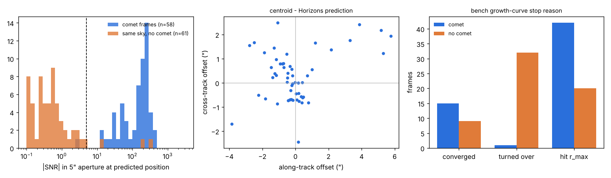

# Field search and aperture extraction on public ZTF images

This test checks whether the test bench's comet search and aperture extraction
work on real survey images. Filters and calibration don't matter here. ZTF
(Palomar 48-inch, about 1"/px, 3072 x 3080 px CCD quadrants) has thousands of
public frames with known comets in them, so it makes a good stand-in.

Run on 2026-11-23 with bench commit 9b85dc2 plus this branch. The bench uses
its default `BenchConfig` throughout: iterative 3" steps to 150", global
background, 10" recentring box, and fixed apertures of 5,000, 10,000, 20,000
and 40,000 km.

## Data set

- **Comet frames:** 61 frames of 22 comets (2018 to 2024), V from about 6
  (C/2020 F3) to about 18, distances from 0.08 au (46P) to 6 au (29P), in the
  g, r and i filters. The frames were chosen from Horizons positions (observer
  Palomar, I41) and an IRSA IBE metadata search. Up to 4 frames per comet, on
  different nights.
- **Control frames:** 61 frames, one per comet frame. Each is the same ZTF
  field, quadrant and filter on another night (20 to 200 days away), when that
  comet was at least 1,000 px off the quadrant. The comet's sky position from
  the comet frame is then measured on the control as a null aperture, so a
  control is the same sky without the comet.
- One control's comet frame returned HTTP 404 from IRSA. In two comet frames
  the comet sat about 10 px past the edge: selection used the linear WCS from
  the metadata, but the real TPV WCS differs. The bench correctly reported
  both as not on the frame. That leaves **58 comet frames with the comet on
  the detector, and 61 controls**.

Files: [`results/frames.csv`](results/frames.csv) (frame list and URLs),
[`results/per_frame.csv`](results/per_frame.csv) (one row per measurement),
[`results/summary.json`](results/summary.json).



## Results

### 1. Blind field search (the UltraSat method)

This step is `find_comets` with sb_ident over the frame footprint and Horizons
placement, with no candidate list and no header OBJECT.

| sb_ident margin | targets found | missed |
|---|---|---|
| 0.1 deg (default) | **49 / 58 (84%)** | 260P x4, 4P x2, 67P x2, 62P x1 |
| 2 deg | **53 / 58 (91%)** | 260P x2, 67P x2, 62P x1 |

- **Fast movers fall outside the default box.** sb_ident's first pass places
  fast movers too poorly for the default box. For 260P at 107"/h, its
  second-pass position matched Horizons to 0.1", but the comet only came back
  once the box half-width reached 2 to 5 deg. 4P came back at 2 deg.
- **sb_ident never returned 67P.** On 2021-11-06 and 2021-11-12, 67P was at
  0.42 au and V about 10. It was missing even from a 20 deg box, in both the
  first pass and the second pass. Horizons placed it correctly.
- **No false comets in the controls.** No control frame returned its paired
  comet. In one control, sb_ident predicted another comet (P/2011 W1, V 19.8),
  but nothing was visible there (SNR 0).
- When named, Horizons put every comet on the right pixels. The cases above
  are discovery failures, not ephemeris errors.

### 2. Position accuracy

These are the 56 comet frames with SNR of 10 or more in a 10" box.

| | value |
|---|---|
| median offset, centroid minus Horizons | **1.1"** |
| 90th percentile | 3.5" |
| maximum | 6.1" (21P at 0.41 au, coma filling the stamp, seeing 3.3") |
| median along / cross track | -0.3" / +0.3" |

On empty sky (the controls), the 10" recentring box wanders a median of 5.2"
(90th percentile 10.2") towards the nearest stars.

### 3. Detection at the predicted position

The rule is SNR of 5 or more in a 5" aperture, with the centroid within 5" of
the prediction.

| | detected |
|---|---|
| comet frames | **56 / 58** |
| controls (same sky, no comet) | **1 / 61** |

- **141P (2021-01-07):** a real non-detection, SNR 2.5. sb_ident predicted
  V 15.8, but the comet is not visible. Predicted magnitudes can be far too
  bright.
- **21P (2018-08-31):** detected at SNR 310, but its centroid sat 5.4" from
  the prediction in a very large coma, just past the 5" rule.
- **The false control:** a dense Milky Way field (C/2017 K2 pair) with a star
  2.7" from the position.

The two populations are separated by about two orders of magnitude in SNR, as
the left panel of the figure shows.

### 4. Iterative (growth-curve) apertures

| stop reason | comet frames (58) | controls (61) |
|---|---|---|
| converged | 15 | 9 |
| turned over | 1 | 32 |
| reached r_max (150") | **42** | 20 |

- **The growth curve rarely converges on a real coma.** In 42 of 58 comet
  frames it ran to 150". This is expected: a 1/rho coma has enclosed flux
  that grows linearly with radius, so it never converges. The curve flattens
  only once the coma drops into the noise or the background is biased. In
  ZTF star fields, stars entering the aperture keep it growing.
- **On empty sky the growth curve still reports a confident flux.** 33 of 61
  controls have SNR above 5 at the "best" radius, and 9 are flagged
  `converged`. That flux is stars. Without a detection gate, a control frame
  would go to the OH package as a measurement.
- **A median-annulus growth curve helps a little.** This experiment, in
  `run_bench.py`, builds the curve from azimuthal medians in 3" annuli, which
  rejects stars. False "converged" controls drop from 9 to 3. Comet
  magnitudes come out 0.2 mag fainter (median), which is roughly the star
  light the bench includes. Real comae still mostly reach r_max, for the
  reason above.

### 5. Fixed physical apertures

| radius | median radius | below 2 x seeing | partly off the frame |
|---|---|---|---|
| 5,000 km | 6.8" | **22 / 58** | 1 |
| 10,000 km | 13.6" | 12 / 58 | 1 |
| 20,000 km | 27.1" | 2 / 58 | 2 |
| 40,000 km | 54.2" | 0 / 58 | 4 |

At 1"/px, the smallest km apertures are often set by the seeing rather than
the coma. At ULTRASAT's 5.4"/px this gets worse; see the plate-scale audit.

### Other notes

- The bench's Poisson errors assume a gain of 1. ZTF's gain is 6.2 e-/DN, so
  errors that are Poisson-dominated are overestimated by about 2.5x. The SNRs
  above are therefore conservative.
- `ApertureResult.coverage` correctly flagged the apertures that ran off the
  frame.

## Suggested changes (not made here)

1. **Field search:**
   - Query sb_ident with a margin of at least 2 deg and let the existing
     pixel test trim the result.
   - Also pass a candidate list of known active comets for the epoch, checked
     with Horizons, since sb_ident can omit a bright comet (67P).
2. **Detection gate:** before photometry is handed off, require something like
   SNR of 5 or more in a small fixed aperture, with the centroid within a few
   arcsec of the prediction. Record failures as non-detections, not fluxes.
3. **Aperture product:**
   - Make fixed physical apertures the primary output, as
     swift_comet_pipeline does.
   - Treat the growth curve as a diagnostic, not as "the" flux.
   - Mask stars, either with median annuli or by subtracting a same-field
     reference image. ULTRASAT revisits fields, so references will exist.
   - Flag apertures smaller than 2 x PSF.
4. **Errors:** add gain and read noise to the instrument adapters.

## Reproduce

```bash
python examples/ztf_aperture_test/select_frames.py frames.csv   # Horizons + IRSA IBE (~30 min)
python examples/ztf_aperture_test/download_frames.py frames.csv raw/   # ~38 MB per frame
python examples/ztf_aperture_test/run_bench.py frames.csv raw/ out/    # ~45 s per frame (two sb_ident calls)
python examples/ztf_aperture_test/analyze.py frames.csv out/results.jsonl analysis/
```

Network access is needed to `irsa.ipac.caltech.edu`, `ssd.jpl.nasa.gov` and
`ssd-api.jpl.nasa.gov`. IRSA answers more than about 2 parallel downloads with
HTTP 503.
